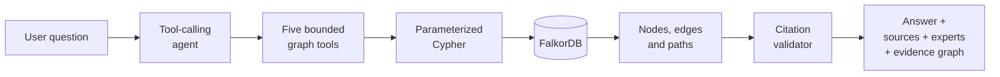
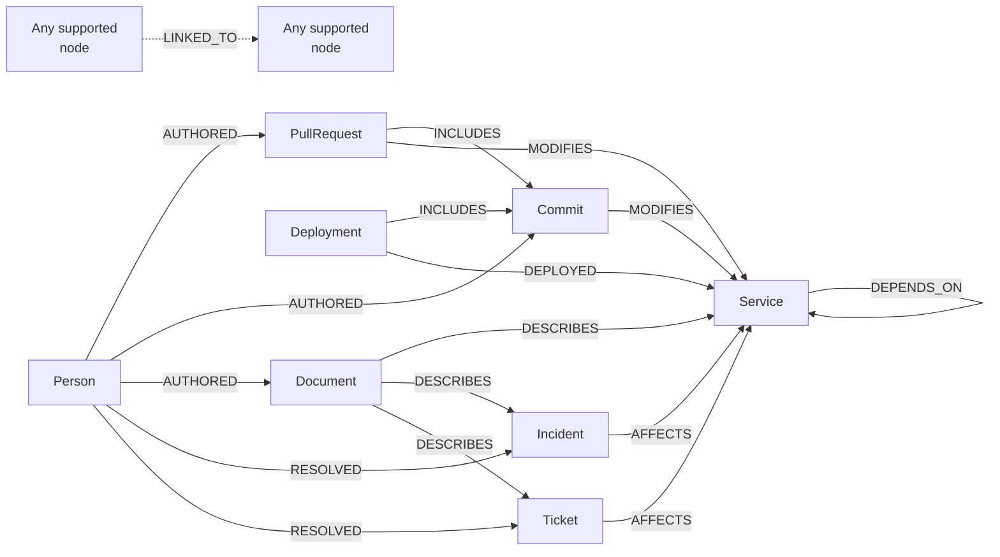
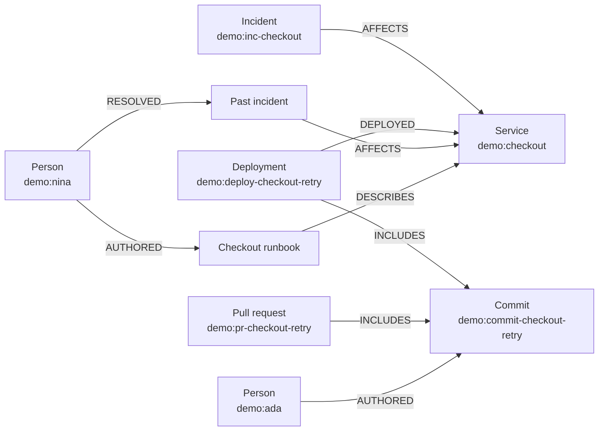

# KnowGraph AI

An evidence-backed engineering company brain powered by **FalkorDB**. KnowGraph investigates incidents, finds experienced engineers and relevant documents, and shows the exact graph paths behind every answer.

Built for **Graph Hacks Track 3** with Python, FastAPI, FalkorDB, Cypher, Next.js, React, and Docker Compose.

## Agent approach

KnowGraph uses a **bounded, graph-first tool-calling agent**. The model chooses a retrieval tool, the backend runs predefined read-only Cypher, and the final answer must cite IDs returned by FalkorDB during that question. The model cannot generate Cypher, mutate the graph, or cite records from an earlier turn.



If a model invents an evidence ID, the backend rejects the generated claims and returns only the records FalkorDB actually found.

## Features

| Feature | What it does |
|---|---|
| Incident investigator | Connects incidents, affected services, dependencies, deployments, commits, pull requests, authors, and previous incidents |
| Expert finder | Ranks people using recorded resolutions, authored changes, and authored documents |
| Documentation finder | Retrieves connected tickets, runbooks, and technical documents |
| Evidence graph | Visualizes and exports the exact directed paths behind results |
| Knowledge updater | Validates and idempotently imports JSON or CSV without duplicate records |

The included fictional Northstar Labs workspace contains **113 nodes, 209 relationships, and three incident scenarios**. Structured investigation, expert, document, graph, and ingestion views work without an LLM key.

## Run locally

Requirements: Git and Docker Desktop or Docker Engine with Compose v2.

```bash
git clone https://github.com/krshn0x/KnowGraph-AI-Standalone.git
cd KnowGraph-AI-Standalone
cp .env.example .env
docker compose up -d --build --wait
```

Open:

- Application: **http://localhost:8501**
- FastAPI documentation: **http://localhost:8000/docs**
- Health check: **http://localhost:8000/health**

Verify the seeded graph:

```bash
curl --fail http://localhost:8000/health
docker compose exec api knowgraph stats
```

Normal restarts preserve FalkorDB data in the `graph-data` volume and seed only an empty graph.

## Go-to questions for the agent

The local and free LLMs this demo runs on are not capable of reasoning over broad, open-ended questions. We have therefore prepared a set of narrower, to-the-point questions that stay within the agent's bounded graph tools and produce reliable, evidence-backed answers.

1. "What is the current status of the checkout service?"
2. "What has Priya worked on recently?"
3. "What documentation exists for the notifications service?"
4. "Which deployments and PRs recently touched the payments service?"
5. "Are there any open incidents right now?"
6. "Who can help me with ledger database problems?"
7. "What tickets are open for the ledger service?"
8. "Who is the strongest expert for analytics issues, and what analytics tickets are still open?"
9. "Who resolved the queue service incidents?"
10. "What changed right before the demo:inc-checkout incident, and which runbook applies?"
11. "What past incidents have affected the queue service?"

## Use any OpenAI-compatible provider

In **AI settings**, choose **OpenAI-compatible API** and enter the provider's API base URL, model ID, and key. The endpoint must support OpenAI-style Chat Completions, function tools, and JSON-object output.

The recommended preset is filled automatically:

| Setting | Recommended value |
|---|---|
| Provider | Token Harbour |
| API URL | `https://tokenharbor.ai/v1` |
| Model | `deepseek-v4.1-flash:free` |

You can replace those values with any compatible provider. Select **Test connection** before saving; the test verifies model access, graph tool calling, and a cited answer without changing saved settings.

To preserve a provider across backend restarts, use the gitignored `.env`:

```dotenv
LLM_PROVIDER=compatible
COMPATIBLE_API_KEY=your-private-key
COMPATIBLE_API_BASE_URL=https://tokenharbor.ai/v1
COMPATIBLE_API_MODEL=deepseek-v4.1-flash:free
```

Then recreate the API container:

```bash
docker compose up -d --build api
```

Existing `TOKENHARBOUR_*` and `AGENTROUTER_*` environment variables remain supported. Keys entered in the UI stay in backend memory, are never returned to the browser, and are cleared when the backend restarts. Never commit a real key.


## Graph data model

Every node has `:Entity` plus one domain label and a stable, source-qualified `id`.

| Node | Represents |
|---|---|
| `Person` | Engineers and contributors |
| `Service` | Applications and service dependencies |
| `PullRequest` | Reviewed code changes |
| `Commit` | Individual code changes |
| `Incident` | Failures, timing, environment, and status |
| `Ticket` | Engineering work and issues |
| `Document` | Runbooks and technical knowledge |
| `Deployment` | Releases to a service and environment |

| Relationship | Direction |
|---|---|
| `AUTHORED` | Person → PullRequest, Commit, or Document |
| `MODIFIES` | PullRequest or Commit → Service |
| `AFFECTS` | Incident or Ticket → Service |
| `RESOLVED` | Person → Incident or Ticket |
| `DEPENDS_ON` | Service → Service |
| `DESCRIBES` | Document → Service, Incident, or Ticket |
| `DEPLOYED` | Deployment → Service |
| `INCLUDES` | Deployment or PullRequest → Commit |
| `LINKED_TO` | Any supported node → any supported node |



## FalkorDB drives the answer

For the checkout incident, FalkorDB supplies each decision:



| Agent result | Graph evidence | Rule |
|---|---|---|
| Candidate change | Incident → Service ← Deployment → Commit | Timing is correlation, not proof of cause |
| Change author | Person → `AUTHORED` → deployed Commit | No author is inferred from a job title |
| Relevant expert | Person → `RESOLVED` → Incident → Service | Only distinct recorded experience earns points |
| Runbook | Document → `DESCRIBES` → Service | The source body and path remain inspectable |

The API returns `tool_calls`, claim-level `evidence_ids`, `sources`, the cited `evidence` subgraph, and broader `retrieved_evidence`. The frontend renders those same returned relationships.

## Cypher used by the agent

Incident scope and dependencies, bounded to two hops:

```cypher
MATCH p=(i:Incident {id:$id})-[:AFFECTS]->(:Service)-[:DEPENDS_ON*1..2]->(:Service)
RETURN [n IN nodes(p) | properties(n)], [r IN relationships(p) | properties(r)]
LIMIT $limit
```

Deployments in the incident's lookback window and environment:

```cypher
MATCH p=(s:Service)<-[:DEPLOYED]-(d:Deployment)
WHERE s.id IN $ids AND d._time >= $start AND d._time <= $end
  AND ($env='' OR d.environment=$env)
RETURN [n IN nodes(p) | properties(n)], [r IN relationships(p) | properties(r)]
LIMIT $limit
```

Exact deployed commit and pull-request lineage:

```cypher
MATCH p=(d:Deployment)-[:INCLUDES]->(c:Commit)<-[:INCLUDES]-(pr:PullRequest)
WHERE d.id IN $ids
RETURN [n IN nodes(p) | properties(n)], [r IN relationships(p) | properties(r)]
LIMIT $limit
```

Recorded expert experience:

```cypher
MATCH p=(person:Person)-[:RESOLVED]->(:Incident)-[:AFFECTS]->(s:Service)
WHERE s.id IN $ids
RETURN [n IN nodes(p) | properties(n)], [r IN relationships(p) | properties(r)]
LIMIT $limit
```

The other expert branches follow `AUTHORED → Commit/PullRequest → MODIFIES → Service` and `AUTHORED → Document → DESCRIBES → Service`. All reads use FalkorDB `GRAPH.RO_QUERY` with a two-second query timeout.

## Graph algorithms and safeguards

| Operation | Implementation |
|---|---|
| Incident investigation | Time- and environment-filtered traversal across affected services and dependencies |
| Expert ranking | Resolved incident = 3, authored change = 2, authored document = 1; repeated paths do not add points |
| Neighborhood exploration | Breadth-first traversal, maximum three hops and 100 returned nodes |
| Search | Exact ID first, then bounded full-text prefix search |
| Citation validation | Every claim must cite a node, edge, or path retrieved for the current question |
| Ingestion | Validated `MERGE` upserts with deterministic relationship IDs and a graph lock |

The agent can call only `search_entities`, `investigate_incident`, `find_experts`, `find_documents`, and `get_evidence_paths`.

## Import data

Upload JSON or CSV from **Data sources**. JSON uses `nodes` and `edges`; CSV uses either the node columns `id,kind,title,body,source_ref,status,environment,occurred_at` or edge columns `source,kind,target,source_ref`.

The importer validates the entire bundle before writing, requires existing edge endpoints, normalizes timestamps to UTC, and safely reuses stable IDs on retries.

## Key API routes

| Route | Purpose |
|---|---|
| `POST /ask` | Evidence-backed agent answer |
| `GET /incidents/{incident_id}/investigation` | Incident graph traversal |
| `GET /experts?q=...` | Relationship-backed expert ranking |
| `GET /documents?q=...` | Connected tickets and documents |
| `GET /graph/neighborhood` | Bounded evidence graph expansion |
| `POST /ingest` | Validated multipart JSON or CSV graph updates |
| `GET /settings/ai`, `POST /settings/ai` | Write-only provider configuration |

## Tests

```bash
python -m pip install -r requirements.lock
python -m pip install --no-deps -e .
docker compose up -d --wait falkordb
RUN_INTEGRATION=1 pytest -q -m 'not live'
ruff check .
ruff format --check .

cd web
npm ci --no-fund
npm run lint
npm run typecheck
npm run build
npm run test:e2e
```

CI runs the Python, FalkorDB integration, frontend, Docker build, browser workflow, and real API proxy checks without paid model credentials.

More detail: [architecture](docs/architecture.md) · [demo script](docs/demo-script.md)
