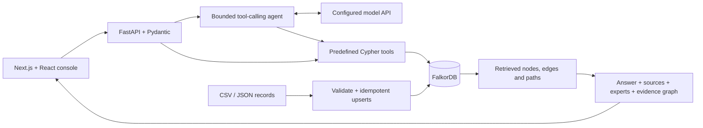
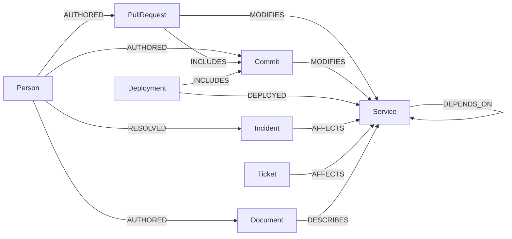

# KnowGraph AI

An engineering company brain powered by **FalkorDB**. Investigate incidents, find experienced people and useful documents, inspect cited graph paths, and update company knowledge without duplicates.

The **Next.js + React + TypeScript** frontend is a dark engineering console: pure black surfaces, white actions, grayscale accents, dense incident context, and an interactive React Flow evidence graph. FastAPI owns the graph and agent logic.

The bundled Northstar Labs workspace is fictional: **113 nodes, 209 relationships, three incident scenarios**. AI settings offer **local Ollama (no API key)**, **Token Harbour / DeepSeek** through OpenAI-compatible Chat Completions, and OpenAI’s Responses API with configurable `gpt-6.1-sol`. All structured investigation, expert, document, graph, and ingestion views work without an API key.

Built for **Graph Hacks Track 3**: connect engineering knowledge, retrieve multi-hop evidence, and explain answers through their sources.

**Contents:** [Setup](#start-with-docker) · [Token Harbour](#connect-token-harbour--deepseek) · [Features and demo](#what-you-can-do) · [Graph data model](#graph-data-model) · [Cypher queries](#cypher-queries) · [Graph algorithms](#graph-algorithms-and-evidence-validation) · [Ingestion](#ingestion-contract) · [API](#api) · [Development and tests](#local-development-and-tests)

## How it works



Python owns retrieval, ingestion, and answer validation. The model chooses among five read-only tools; the server executes their predefined queries, validates every cited ID, and returns the graph relationships supporting the answer. File ingestion runs separately from chat.

## Start with Docker

**Prerequisites:** Git and a running Docker Desktop/Engine with Docker Compose v2. Docker supplies Python, Node.js, and FalkorDB; host Python and Node installations are needed only for [native development](#local-development-and-tests). An LLM key is optional for the structured investigation, expert, document, and graph views.

From a new checkout:

```bash
git clone https://github.com/krshn0x/KnowGraph-AI-Standalone.git
cd KnowGraph-AI-Standalone
cp .env.example .env
# Optional: configure provider credentials in .env, or use AI settings in the app.
docker compose up -d --build --wait
```

Open **http://localhost:8501** for the dashboard and **http://localhost:8000/docs** for the API. Compose starts FalkorDB, seeds an empty graph, starts the API, then starts the Next.js standalone server. Initial startup downloads images and dependencies. Check startup with `docker compose ps` and `docker compose logs api seed frontend`.

| Service | Local address | Purpose |
|---|---|---|
| Next.js frontend | `http://localhost:8501` | Dashboard, chat, and evidence explorer |
| FastAPI | `http://localhost:8000/docs` | Interactive API documentation |
| Health check | `http://localhost:8000/health` | Database readiness, counts, and model configuration |
| FalkorDB | `localhost:6379` | Redis-compatible graph connection |

Verify the seeded workspace:

```bash
curl --fail http://localhost:8000/health
docker compose exec api knowgraph stats
```

A fresh seed reports `{"nodes": 113, "edges": 209}`. Counts can differ after imports. `ai_configured` reports configuration presence; use **AI settings → Test connection** to verify model access, graph tool calling, and a cited answer.

A named volume persists FalkorDB's actual data directory (`/var/lib/falkordb/data`); append-only persistence is enabled. Normal startup skips seeding an existing graph, preserving imported updates. `docker compose down` retains the volume. Services are published on loopback for this local single-user prototype.

If port 6379 is already occupied, set `FALKORDB_PORT=6380` in `.env`. Container-to-container connections still use 6379. After changing provider settings in .env, run `docker compose up -d api`. Credentials stay in the backend; never commit `.env`.

## Run local AI with Ollama

In **AI settings**, choose **Local Ollama**, select the downloaded model, and save. The starter model is `qwen3:4b`, which [supports tools](https://ollama.com/library/qwen3:4b). This provider uses Ollama’s local API without an API key; cloud provider credentials are never sent to it.

**Use an Ollama server on your computer:**

1. [Install and start Ollama](https://ollama.com/download).
2. Download the starter model: `ollama pull qwen3:4b` (approximately 2.5 GB).
3. Set the API URL in AI settings to `http://host.docker.internal:11434/v1` when the KnowGraph backend runs in Docker Desktop, or `http://127.0.0.1:11434/v1` for native Python development.
4. Save, then use Ask KnowGraph. The model must support tool calling and JSON output.

For larger evidence payloads, use a 16K context window. When starting Ollama from a terminal, use `OLLAMA_CONTEXT_LENGTH=16384 OLLAMA_NO_CLOUD=1 ollama serve`. For an existing app/service, follow [Ollama’s environment configuration](https://docs.ollama.com/faq#how-can-i-specify-the-context-window-size). On Linux, a container cannot reach a host service bound only to host loopback; configure an appropriate host interface or use the Compose option below.

**Use the optional Compose Ollama service:**

```bash
docker compose --profile local-ai up -d --wait ollama
docker compose --profile local-ai exec ollama ollama pull qwen3:4b
```

Then choose **Local Ollama** in AI settings and set the API URL to **http://ollama:11434/v1**. This service has cloud features disabled, a 16K context window, a persistent model volume, and a loopback-only published port. It runs only when the `local-ai` profile is requested. Model speed depends on your hardware; the profile uses CPU inference by default.

To preserve the provider choice across backend restarts, set the gitignored `.env`:

```dotenv
LLM_PROVIDER=ollama
OLLAMA_MODEL=qwen3:4b
# Use host.docker.internal for a host server, or ollama for the Compose service.
OLLAMA_BASE_URL=http://ollama:11434/v1
```

Run `docker compose up -d api` after environment changes. Ollama gets a **300-second total investigation budget** by default, including model loading and every graph tool round trip. In **AI settings → Local Ollama**, set **Investigation deadline** to 600 seconds for a slower machine (maximum 900). The saved value applies to new questions immediately; it is held for the backend session. To preserve it after restarts, set `OLLAMA_DEADLINE_SECONDS=600` in `.env` and recreate the API with `docker compose up -d api`. Editing `.env` alone or using `docker compose restart` does not update the container’s environment.

When `OLLAMA_DEADLINE_SECONDS` is unset, the local budget is the larger of 300 and `AGENT_DEADLINE_SECONDS`, so existing increases to the shared setting still work. An explicit Ollama value overrides that fallback. Hosted providers retain the default 60-second shared deadline. The local adapter requests at most 1,536 output tokens per turn by default (`OLLAMA_MAX_OUTPUT_TOKENS`, range 256–4,096); thinking is disabled where the model supports it. The frontend allows the backend’s full 900-second maximum, including slow response headers. Hosting platforms may impose their own execution limits.

A **tool-call limit** is separate from a timeout: the agent permits up to 16 graph tool calls by default (8 before v0.2, configurable up to 24), then asks for a final answer. A model that continues calling tools receives a distinct warning; increasing the deadline does not change this limit. Deadline warnings show the effective seconds and tool count, and all failures preserve retrieved graph evidence. There is no automatic cloud fallback.

For slow local models, run `ollama ps` to check whether inference uses CPU or GPU. Prefer the native Ollama app on macOS: [Docker Desktop on macOS does not support Ollama GPU acceleration](https://docs.ollama.com/faq#how-do-i-use-ollama-with-gpu-acceleration-in-docker). Preload the selected model with `ollama run qwen3:4b ""` before asking; [Ollama keeps models loaded for five minutes by default](https://docs.ollama.com/faq#how-do-i-keep-a-model-loaded-in-memory-or-make-it-unload-immediately).

## Connect Token Harbour / DeepSeek

Open **AI settings** in the top bar (also available from Ask KnowGraph and System status):

1. Choose **Token Harbour**.
2. New connections prefill **https://tokenharbor.ai/v1** and **deepseek-v4.1-flash:free**. Existing custom settings are preserved, and both fields remain editable.
3. Verify your Token Harbour account email and paste the API key into the password field.
4. Select **Test connection**, then **Save AI settings** after a successful test. Open **Ask KnowGraph** to chat.

Token Harbour [documents](https://tokenharbor.ai/docs/api/curl) an OpenAI-compatible Chat Completions endpoint. The adapter requires function tools and JSON-object output; model IDs are passed through unchanged. Free-route availability and quotas depend on your Token Harbour account.

Other OpenAI-compatible gateways remain supported by editing the endpoint and model.

Keys entered in the app are held in **backend memory for that server session**. They are never returned by the settings API, placed in browser storage, or written to source files. Leave a saved key blank to keep it; **Disconnect provider** clears it for the session. Restarting the backend restores environment configuration. These settings belong to the local, single-user workspace.

For configuration that survives a restart, put these values in the gitignored root `.env`:

```dotenv
LLM_PROVIDER=tokenharbour
TOKENHARBOUR_API_KEY=your-key
TOKENHARBOUR_BASE_URL=https://tokenharbor.ai/v1
TOKENHARBOUR_MODEL=deepseek-v4.1-flash:free
```

Then run `docker compose up -d --build api`. For OpenAI, select it in AI settings or use `LLM_PROVIDER=openai`, `OPENAI_API_KEY`, and `OPENAI_MODEL`. Provider keys remain separate; a Token Harbour configuration never falls back to an OpenAI key.

## What you can do

| View | Behavior |
|---|---|
| Overview | Live graph counts, recent incidents, and a connected investigation map. |
| Ask KnowGraph | Natural-language questions, bounded conversation history, model-selected graph tools, cited claims, experts, and sources. |
| Investigations | Timeline, affected services, dependencies, deployments preceding onset, included commits/PRs, authors, similar incidents, and resolution notes. |
| Experts | Search independently by service, incident ID, or topic. Rank distinct records: resolved incident = 3, authored change = 2, authored document = 1. Latest activity breaks ties. |
| Documents | Full-text search for documents/tickets plus connected service and incident evidence. Inspect original source bodies and references. |
| Evidence Graph | Interactive directed graph with source inspection and path highlighting. Cited answer evidence is separate from additional retrieved context and neighborhood exploration. |
| Data sources | Upload JSON or node/edge CSV files; validate before writes; display created/updated/unchanged/rejected counts. |

Use **Cmd/Ctrl + K** to search source records from any screen. Graphs support pan, zoom, dragging nodes, path highlighting, source inspection, layout reset, and JSON export. Mobile navigation and layouts adapt to smaller screens. Every displayed metric comes from the API.

Incident investigation defaults to the preceding **24 hours**, matches the incident environment, and traverses up to two service-dependency hops. Deployment timing is evidence of correlation. A causal explanation remains a hypothesis unless source records explicitly establish a resolution.

## Demo in three minutes

1. In **Investigations**, investigate “Checkout errors after morning release” (`demo:inc-checkout`). Inspect `demo:deploy-checkout-retry` → commits → PR → Ada. Staging, future, old, and unrelated releases are excluded.
2. Find checkout experts and the checkout retry runbook. Nina ranks highly from recorded resolutions, changes, and documents.
3. Investigate `demo:inc-payments`: follow payments → ledger to the ledger deployment. Investigate `demo:inc-queue`: historical incidents and Mei's experience help despite no recent worker deployment.
4. In **Data sources**, upload `data/resolution_update.json`. Reinvestigate checkout: the incident is resolved and the newly recorded resolution is visible. Reimport the same file to see unchanged counts.
5. With a key configured, ask: “Investigate demo:inc-checkout. What changed, who can help, and which runbook should I read?” Open the cited evidence graph.

[Detailed demo script](docs/demo-script.md) · [Architecture and schema](docs/architecture.md)

## Graph data model

FalkorDB stores a property graph named `knowgraph` by default (`FALKORDB_GRAPH` changes it). Every node has the common `:Entity` label and one kind label, such as `:Entity:Incident`. The canonical enums and validation rules live in [models.py](knowgraph/models.py) and [ingestion.py](knowgraph/ingestion.py).

| Node kind | Represents | Example ID |
|---|---|---|
| `Person` | Engineers and recorded contributors | `demo:ada` |
| `Service` | Applications and service dependencies | `demo:checkout` |
| `PullRequest` | Reviewed changes connected to services and commits | `demo:pr-checkout-retry` |
| `Commit` | Individual code changes | `demo:commit-checkout-retry` |
| `Incident` | Failures, onset times, and resolution status | `demo:inc-checkout` |
| `Ticket` | Engineering work and issue records | `demo:ticket-checkout-1` |
| `Document` | Runbooks, technical docs, and resolution notes | `demo:doc-checkout-runbook` |
| `Deployment` | Releases to a service and environment | `demo:deploy-checkout-retry` |

New records require `id`, `kind`, `title`, and `source_ref`. Optional properties are `body`, `occurred_at`, `status`, and `environment`; new incidents and deployments also require a timezone-aware `occurred_at`. Timestamps are normalized to UTC, and a private integer `_time` stores epoch seconds for deployment/incident filtering. IDs are source-qualified and stable across imports. `source_ref` retains the originating record URL or fixture reference.

All stored relationships are directed. Ingestion accepts these endpoint types:

| Relationship | Source → target | Use |
|---|---|---|
| `AUTHORED` | Person → PullRequest, Commit, or Document | Find contributors |
| `MODIFIES` | PullRequest or Commit → Service | Associate changes with a service |
| `AFFECTS` | Incident or Ticket → Service | Establish affected services |
| `RESOLVED` | Person → Incident or Ticket | Record resolution experience |
| `DEPENDS_ON` | Service → Service | Follow upstream dependencies |
| `DESCRIBES` | Document → Service, Incident, or Ticket | Connect documentation |
| `DEPLOYED` | Deployment → Service | Associate releases with services |
| `INCLUDES` | Deployment or PullRequest → Commit | Link a deployed commit to its pull request |
| `LINKED_TO` | Any supported node kind → any supported node kind | Preserve explicit cross-references |



For example, an investigation connects `Incident → Service ← Deployment → Commit ← PullRequest ← Person`. It joins through commits explicitly included in a deployment, rather than treating every PR touching a service as a deployed change. The diagram shows the main paths; the table lists every allowed relationship.

Initialization creates an exact-match index with `CREATE INDEX ON :Entity(id)` and a title/body full-text index with `CALL db.idx.fulltext.createNodeIndex('Entity', 'title', 'body')`. Relationship IDs are `edge:` plus the first 24 hex characters of SHA-256 over `source|kind|target`; this preserves identity for directed relationships across retries. The implementation is in [GraphStore](knowgraph/graph.py).

## Cypher queries

These examples mirror the query templates in [graph.py](knowgraph/graph.py) and [retrieval.py](knowgraph/retrieval.py). Each `Parameters` comment gives sample driver bindings for the bundled data. Read queries return node/relationship properties so the server can build evidence paths; the application requests one extra path beyond its display limit to detect truncation.

To run a parameterized read from the repository root after [Python setup](#local-development-and-tests):

```python
from knowgraph.config import Settings
from knowgraph.graph import GraphStore

store = GraphStore(Settings())
try:
    rows = store.read(
        "MATCH (n:Entity {id:$id}) RETURN properties(n)",
        {"id": "demo:inc-checkout"},
    )
    print(rows)
finally:
    store.close()
```

### 1. Search source records

Search first attempts exact ID lookup. Otherwise it constructs a prefix-only full-text query from at most 12 word tokens; user-supplied search operators are not forwarded to FalkorDB.

```cypher
// Parameters: {"term":"retry* saturation*","kinds":["Document","Ticket"],"limit":20}
CALL db.idx.fulltext.queryNodes('Entity', $term) YIELD node, score
WHERE size($kinds)=0 OR node.kind IN $kinds
RETURN properties(node)
ORDER BY score DESC, node.id
LIMIT $limit
```

### 2. Follow incident dependencies

The investigator separately retrieves the incident's direct `AFFECTS` edges, then follows up to two directed dependency hops:

```cypher
// Parameters: {"id":"demo:inc-checkout","limit":101}
MATCH p=(i:Incident {id:$id})-[:AFFECTS]->(:Service)-[:DEPENDS_ON*1..2]->(:Service)
RETURN [n IN nodes(p) | properties(n)], [r IN relationships(p) | properties(r)]
LIMIT $limit
```

### 3. Filter candidate deployments by time and environment

`$ids` contains the affected service and dependency IDs. `$start` and `$end` are computed from the incident onset and lookback, with inclusive endpoints. This example uses the seeded checkout incident's 24-hour window ending at `2026-10-15T10:00:00Z`; an empty `$env` disables environment filtering.

```cypher
// Parameters: {"ids":["demo:checkout","demo:payments","demo:ledger"],"start":1791972000,"end":1792058400,"env":"production","limit":101}
MATCH p=(s:Service)<-[:DEPLOYED]-(d:Deployment)
WHERE s.id IN $ids AND d._time >= $start AND d._time <= $end
  AND ($env='' OR d.environment=$env)
RETURN [n IN nodes(p) | properties(n)], [r IN relationships(p) | properties(r)]
LIMIT $limit
```

### 4. Connect deployed commits to pull requests and authors

The deployment IDs come from the filtered candidate set above:

```cypher
// Parameters: {"ids":["demo:deploy-checkout-retry"],"limit":101}
MATCH p=(d:Deployment)-[:INCLUDES]->(c:Commit)<-[:INCLUDES]-(pr:PullRequest)
WHERE d.id IN $ids
RETURN [n IN nodes(p) | properties(n)], [r IN relationships(p) | properties(r)]
LIMIT $limit
```

The investigator also retrieves deployment → commit paths directly, so a deployed commit remains visible when no PR is recorded. It resolves authors from the retrieved commit and PR IDs:

```cypher
// Parameters: {"ids":["demo:commit-checkout-retry","demo:pr-checkout-retry"],"limit":101}
MATCH p=(person:Person)-[:AUTHORED]->(c:Entity)
WHERE c.id IN $ids
RETURN [n IN nodes(p) | properties(n)], [r IN relationships(p) | properties(r)]
LIMIT $limit
```

### 5. Retrieve evidence for expert ranking

One of the three expert evidence queries finds people who resolved incidents affecting the selected service:

```cypher
// Parameters: {"ids":["demo:checkout"],"limit":101}
MATCH p=(person:Person)-[:RESOLVED]->(:Incident)-[:AFFECTS]->(s:Service)
WHERE s.id IN $ids
RETURN [n IN nodes(p) | properties(n)], [r IN relationships(p) | properties(r)]
LIMIT $limit
```

The other branches retrieve `Person -AUTHORED→ Commit/PullRequest -MODIFIES→ Service` and `Person -AUTHORED→ Document -DESCRIBES→ Service`. Python deduplicates supporting records and computes the scores described [below](#graph-algorithms-and-evidence-validation).

### 6. Find connected documentation

```cypher
// Parameters: {"ids":["demo:checkout"],"limit":101}
MATCH p=(d:Document)-[:DESCRIBES]->(s:Service)
WHERE s.id IN $ids
RETURN [n IN nodes(p) | properties(n)], [r IN relationships(p) | properties(r)]
LIMIT $limit
```

Documentation retrieval merges these results with full-text Document/Ticket hits, tickets connected through `AFFECTS`, documents describing a supplied incident/ticket ID, and explicit `DESCRIBES`, `AFFECTS`, or `LINKED_TO` relationships around text-search hits.

### 7. Expand one layer of the evidence neighborhood

```cypher
// Parameters: {"ids":["demo:checkout"],"limit":401}
MATCH p=(a:Entity)-[]-(b:Entity)
WHERE a.id IN $ids
RETURN [n IN nodes(p) | properties(n)], [r IN relationships(p) | properties(r)]
LIMIT $limit
```

This query searches either relationship direction for exploration. `GraphStore.neighborhood()` repeats it breadth-first with a visited set, at most three hops, and a maximum of 100 returned nodes. Stored edge direction is retained in the evidence graph.

### 8. Update knowledge without duplicates

Only the validated ingestion pipeline runs writes. These examples use the validated `Service` and `DEPENDS_ON` enum values; other labels/types are selected from the same allowlist. All record values are parameters.

```cypher
// Parameters: {"id":"company:checkout","props":{"id":"company:checkout","kind":"Service","title":"Company checkout","source_ref":"fixture://company/checkout"}}
MERGE (n:Entity {id:$id})
SET n:Service
SET n += $props
```

```cypher
// Parameters: {"source":"company:checkout","target":"demo:payments","id":"edge:5d4c0937be34a480b0559460","props":{"source":"company:checkout","target":"demo:payments","kind":"DEPENDS_ON","id":"edge:5d4c0937be34a480b0559460"}}
MATCH (a:Entity {id:$source}), (b:Entity {id:$target})
MERGE (a)-[r:DEPENDS_ON {id:$id}]->(b)
ON CREATE SET r.source_ref=''
SET r += $props
```

Whole-upload validation and a renewable Redis import lock precede these upserts. Omitted fields remain unchanged. Repeating an import updates the same IDs instead of creating duplicate records. Use the [ingestion API](#ingestion-contract) for normal updates.

## Graph algorithms and evidence validation

The project combines bounded graph traversal with Python scoring and validation. It does not depend on a graph analytics plugin.

| Algorithm | Implementation and bounds | Result |
|---|---|---|
| Incident investigation | Direct affected services → up to two directed dependency hops → deployments in the requested time/environment window → included commits, PRs, and authors; enrich with earlier incidents, resolvers, and resolution documents | Candidate changes, chronological timeline, and actual supporting paths |
| Expert ranking | Deduplicate each person's supporting records by record ID; sum **3 per resolved incident**, **2 per authored commit or PR**, **1 per authored document**; break ties by latest supporting activity, then person ID; return up to 10 people | Explainable expertise scores with source records |
| Neighborhood exploration | Breadth-first expansion with a visited set; up to three layers, 400 accepted paths per queried layer, and 100 returned nodes; report truncation | Bounded evidence subgraph without inventing links |
| Evidence assembly | Merge nodes, edges, and paths by ID; path IDs are `path:` plus 24 SHA-256 hex characters over the ordered node IDs followed by edge IDs | Stable references to retrieved relationships |
| Citation validation | Parse the model's answer with Pydantic; require every claim's evidence IDs to belong to the current question's retrieved nodes, edges, or paths; build the displayed graph from cited evidence | Unsupported IDs reject the generated answer; retrieved records remain available |

Expert scores are computed from explicit graph relationships, not inferred from job titles. In the unchanged seed, Nina's checkout score is **13**: two resolved incidents (6), two authored changes (4), and three authored documents (3). Both a commit and its PR can contribute if they are distinct recorded contributions; repeated paths to the same record do not increase its score.

All retrieval reads use FalkorDB `GRAPH.RO_QUERY` with a two-second query timeout. The model selects `search_entities`, `investigate_incident`, `find_experts`, `find_documents`, or `get_evidence_paths`; it cannot submit arbitrary Cypher or mutate the graph. The agent permits up to sixteen tool calls by default and validates citations after fresh retrieval on every question. Deployment timing establishes correlation, and citation validation establishes traceability; neither alone proves a causal diagnosis.

## Ingestion contract

Upload through the dashboard or `POST /ingest` as multipart form data:

- `bundle_file`: JSON containing `nodes` and `edges`; **or**
- `nodes_file` and/or `edges_file`: CSV with header fields matching the JSON fields.

Example JSON:

```json
{
  "nodes": [
    {"id": "company:checkout", "kind": "Service", "title": "Checkout", "source_ref": "https://example.com/services/checkout"}
  ],
  "edges": []
}
```

Examples covering every node/relationship type are in `data/demo.json`, `data/nodes.csv`, and `data/edges.csv`. `python data/build_demo.py` regenerates these fixtures deterministically.

- IDs are stable, source-qualified strings such as `company:checkout` or `github:team/repo/pr/42`. New nodes require `id`, `kind`, `title`, and `source_ref`.
- Optional node fields: `body`, `occurred_at`, `status`, `environment`. New incidents and deployments require timezone-aware `occurred_at`.
- Edges require `source`, `kind`, and `target`; `source_ref` is optional. Identity is the directed source/type/target tuple.
- Both endpoints must already exist or appear in the same upload. Relationship directions/types, duplicate records within an upload, field sizes, and timestamps are validated before any write.
- Omitted fields preserve existing values; explicit node nulls are rejected. Node kinds cannot change. Omitted records are never deleted. Empty optional CSV cells mean “not supplied.”
- Imports are serialized with a Redis lock. A valid import interrupted by database failure can be retried safely; it is **not** a multi-record transaction. Full validation errors cause zero writes.
- Maximum upload: 8 MiB, 2,000 nodes, and 5,000 edges. Counts include both nodes and edges. Validation errors return HTTP 422; oversized uploads return 413.

```bash
curl -F bundle_file=@data/resolution_update.json http://localhost:8000/ingest
```

## API

| Endpoint | Returns |
|---|---|
| `POST /ask` | `{question, history?}` → claims, citations, sources, experts, cited `evidence`, additional `retrieved_evidence`, warnings, status, tool trace. |
| `GET /incidents/{id}/investigation?lookback_hours=24` | Deterministic investigation and timeline. |
| `GET /experts?q=demo:checkout` | Scored experts and supporting paths. |
| `GET /documents?q=checkout%20retry` | Relevant source records and relationships. |
| `GET /graph/neighborhood?node_id=demo:checkout&hops=2` | At most three hops and 100 nodes; truncation is reported. |
| `GET /entities?kind=Incident&q=checkout` | Record selection/search; `q` is optional. |
| `GET /entities/{id}` | Source body and metadata. |
| `POST /ingest` | Import summary or validation errors. |
| `GET /health` | Database readiness, record counts, selected provider/model, and configuration status. |
| `GET /settings/ai` | Selected provider and configuration metadata; keys are never returned. |
| `POST /settings/ai/test` | Test entered settings with a small graph question (up to 90 seconds), without saving them. Returns sanitized provider-specific errors. |
| `POST /settings/ai` | `{provider, model, base_url?, api_key?}` → update the backend session. Omit the key to preserve it; an empty key disconnects it. |

History accepts up to 12 `{role: "user" | "assistant", content: "..."}` messages. Questions are limited to 4,000 characters. Chat history lives in browser memory across console navigation and resets on reload, while company knowledge persists in FalkorDB.

The old `/chat` URL remains an alias for `/ask`, with the **new response schema**. AI provider configuration uses `LLM_PROVIDER` and the corresponding provider variables documented above. This version uses canonical `:Entity` nodes and source-qualified IDs; old demo records are not migrated or deleted. Select a fresh `FALKORDB_GRAPH` name if you want an entirely separate workspace.

## Local development and tests

Python **3.13+** and Node.js **22+** are required; containers and CI use Python 3.13 and Node 24.

```bash
python3 -m venv .venv
source .venv/bin/activate
pip install -r requirements.lock
pip install --no-deps -e .
cp .env.example .env

docker compose up -d --wait falkordb
knowgraph seed
uvicorn knowgraph.api:app --host 127.0.0.1 --port 8000
# In another terminal:
cd web
npm ci
cp .env.example .env.local
npm run dev
```

Open **http://localhost:3000** during development. The Next.js server proxies `/api/*` to `API_BASE_URL` (default `http://127.0.0.1:8000`). Configure it in `web/.env.local` for local development; Compose supplies its internal API address at runtime. Provider credentials stay exclusively in FastAPI. Keep the API and frontend running in separate terminals; use a third terminal for tests. If you already created `.env` during Docker setup, reuse that file.

`knowgraph stats` prints canonical graph counts. Explicit `knowgraph seed` merges the fixture, so use it intentionally: it can restore fixture fields changed by a previous import. Automatic Compose seeding uses `--only-if-empty` instead.

```bash
pytest -q -m 'not integration and not live'
RUN_INTEGRATION=1 pytest -q -m 'not live'
ruff check .
ruff format --check .
```

Integration tests create unique temporary graphs and delete those graphs afterward. They exercise actual Cypher, ingestion retries/concurrency, the three scenarios, document search, evidence consistency, and API contracts. Unit tests use mock HTTP transports to exercise provider adapters, including DeepSeek reasoning replay, citation rejection, limits, missing credentials, outages, and provider failures. Settings tests verify write-only credentials, sanitized validation, configuration switching, client cleanup, and session reset.

The browser suite covers source inspection, graph paths/export, incident controls, expert/document search, uploads, citations, conversation continuity, errors, and mobile navigation. Fixture responses are fictional seed data and are intercepted only inside tests. CI builds both Docker images and also tests the real same-origin API proxy and multipart validation.

```bash
cd web
npm run lint
npm run build
npm run typecheck
npx playwright install chromium
npm run test:e2e
# Against a running Docker stack, including the real API proxy check:
PLAYWRIGHT_BASE_URL=http://127.0.0.1:8501 KNOWGRAPH_LIVE_API=1 npm run test:e2e
```

Optional live-model evaluation incurs API usage:

```bash
RUN_LIVE_MODEL=1 RUN_INTEGRATION=1 pytest -q -m live
```

It requires a running model for Ollama, or credentials and model access for Token Harbour or OpenAI. CI runs without paid credentials. A configured key in `/health` indicates configuration only; it does not prove model access or provider availability.

## Limits and failure behavior

- The agent has five predefined read-only graph tools, up to 16 tool calls (`AGENT_MAX_TOOL_CALLS`, maximum 24), and default investigation deadlines of 300 seconds for Ollama and 60 seconds for hosted providers (configurable up to 900). Each graph query has a two-second execution timeout. No model-generated Cypher is executed.
- Citation IDs must have been retrieved during the current question. This validates traceability, not semantic truth; inspect source bodies when judging a hypothesis.
- Missing key, provider failure, malformed output, and time/tool limits retain available source evidence and show an explicit warning. Structured feature views remain available without the model.
- Database outages return a sanitized HTTP 503. Unknown records return 404. Search is lexical full-text prefix matching with all supplied terms required, rather than embedding similarity.
- Live GitHub ingestion, authentication/company permissions, cloud hosting, autonomous remediation, and embeddings are deferred. GitHub is used for source control and automated checks.
