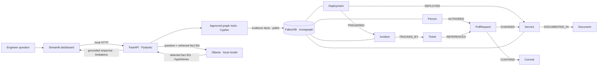

# KnowGraph AI architecture

All AcmePay records shown below are synthetic demo fixtures. Arrows are seeded relationship directions; the evidence graph view renders API-returned paths only.

The deployment/incident/change chain is the fixture's central scenario. The current fixture has no service-to-service dependency edge. Model-selected hypotheses, if returned, must cite evidence IDs and are displayed separately from graph-supported facts.
