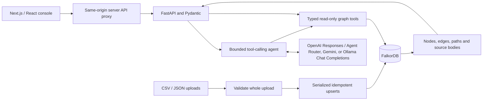

# Architecture

The API owns all business logic. The TypeScript console consumes typed JSON through a server-only Next.js route handler. React Flow and Dagre display actual evidence nodes, directed relationships, and selectable paths. The persistent workspace layout retains chat and selected incident state across navigation; a full reload clears browser memory. The proxy forwards JSON and multipart requests to a runtime API_BASE_URL, with no public provider credentials. The model selects tools and composes claims; the server validates citations and constructs the evidence graph from actual retrieved records. Cited evidence is returned separately from the complete retrieval context.

## Model providers and credentials

`ModelSession` adapts the existing bounded agent to OpenAI Responses or OpenAI-compatible Chat Completions for Agent Router, Google Gemini, and Ollama. Gemini uses a fixed Google endpoint and its own key; opaque Google thought signatures are replayed on every tool turn and never returned as evidence. Tool planning and final JSON formatting are separate for Gemini. The router adapter uses JSON-object output plus server-side Pydantic validation and replays DeepSeek `reasoning_content` with tool calls when present. Reasoning is never exposed as evidence. All providers use the same five read-only tools, citation allowlist, deadline, and tool-call budget; there is no automatic cross-provider fallback.

The settings API accepts credentials as write-only fields and returns only whether a key exists. Invalid settings requests receive sanitized errors without raw request values. UI changes live in backend process memory and affect new questions; each question uses an immutable configuration snapshot and closes its provider client afterward. A restart restores environment settings. This prototype uses one backend process and loopback-only ports, with no multi-user authentication.

The Ollama adapter uses the same Chat Completions tool loop with a non-secret SDK placeholder key. Cloud credentials are never used, and there is no provider fallback. Local endpoint validation supports loopback, private LAN addresses, the Docker host gateway, and the optional Compose service. Tool planning stays separate from final JSON formatting. The optional `local-ai` profile disables Ollama cloud features and persists downloaded models separately from FalkorDB. HTTP readiness reports configuration, while model availability is checked when asking a question.

## Graph schema

Every record has `:Entity` plus its kind label: Person, Service, PullRequest, Commit, Incident, Ticket, Document, or Deployment. IDs are source-qualified. Record fields are flat FalkorDB properties; timestamps are normalized to UTC with an internal numeric field for time filtering. Indexes support entity IDs and full-text title/body search.

| Edge | Direction |
|---|---|
| AUTHORED | Person → PullRequest, Commit, Document |
| MODIFIES | PullRequest or Commit → Service |
| AFFECTS | Incident or Ticket → Service |
| RESOLVED | Person → Incident or Ticket |
| DEPENDS_ON | Service → Service |
| DESCRIBES | Document → Service, Incident, Ticket |
| DEPLOYED | Deployment → Service |
| INCLUDES | Deployment or PullRequest → Commit |
| LINKED_TO | Explicit record → record cross-reference |

An investigation starts from an incident's AFFECTS edges, follows at most two DEPENDS_ON hops, then finds deployments in the chosen time window/environment. Only commits explicitly included by those deployments are candidates; PRs connect through those exact commits. Previous incidents, resolvers, authors, and resolution documents provide additional context.

## Agent boundaries

Tools: `search_entities`, `investigate_incident`, `find_experts`, `find_documents`, `get_evidence_paths`. Their arguments are Pydantic validated. Database reads use `GRAPH.RO_QUERY` and predefined parameterized Cypher; the agent cannot write the graph. Model tool execution is sequential with eight-call and 60-second default limits. SDK retries are disabled so repeated requests cannot silently expand the budget.

Responses contain observed findings and hypotheses with evidence IDs. Unknown IDs invalidate the generated answer. Relationship claims should cite path IDs for exact visual inspection. Source text is treated as data, and history cannot authorize citations that were not retrieved again.

## Persistence and updates

Compose uses the pinned FalkorDB image digest and mounts `/var/lib/falkordb/data`, with AOF persistence enabled. Automatic seeding runs only on an empty canonical graph. The API and CLI share a renewable Redis import lock. Validation completes before writes; each node/edge upsert is retry-safe. Interrupted valid imports may be partially applied and are repaired by retrying. The prototype has no deletion API or background synchronization.
